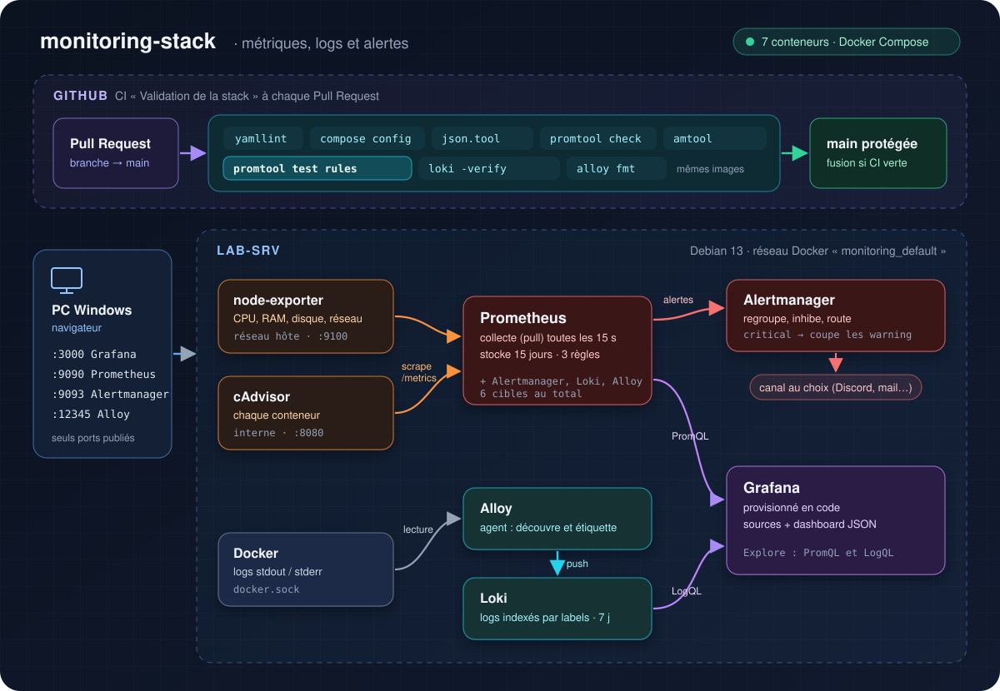
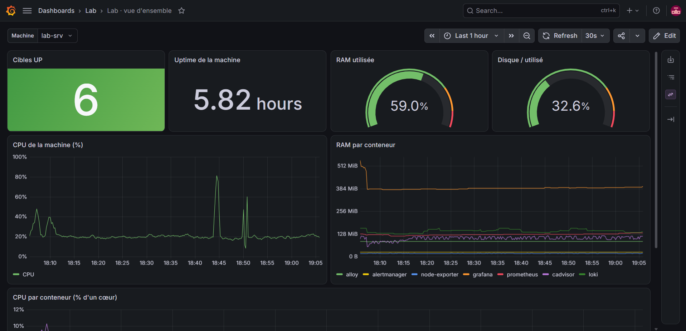
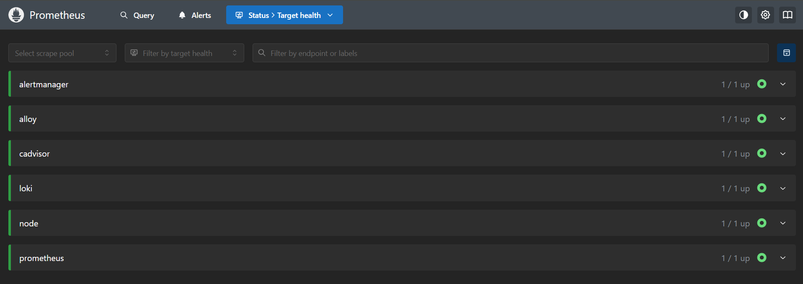
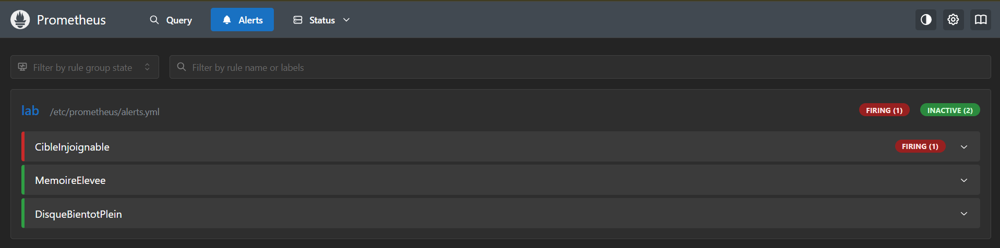
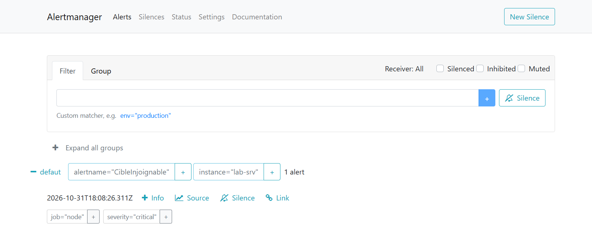
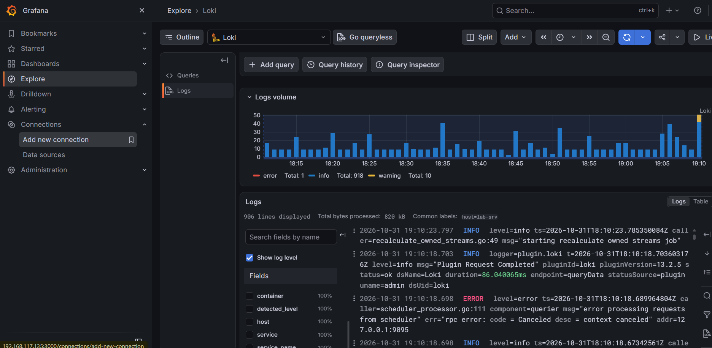

# monitoring-stack

[](https://github.com/Safidy21/monitoring-stack/actions/workflows/ci.yml)

Stack de supervision conteneurisée : **métriques** (Prometheus), **logs** (Loki),
**alertes** (Alertmanager) et **visualisation** (Grafana), décrite entièrement
en code et validée automatiquement à chaque Pull Request.

## Contexte

Ce lab reproduit le contexte d'un projet réel de supervision de serveurs et
d'applications : métriques des machines et des conteneurs, logs centralisés,
alertes.

L'objectif est d'appliquer à cette stack les bonnes pratiques de travail :
- **tout en code** : sources de données et dashboards Grafana provisionnés par fichiers, rien n'est configuré à la souris ;
- **chaque composant validé par son propre outil** (promtool, amtool, loki, alloy) ;
- **des alertes testées** : une panne simulée doit déclencher l'alerte au bon moment ;
- **une CI GitHub Actions** sur chaque Pull Request, et une branche `main` protégée ;
- **aucun secret dans le dépôt** : identifiants dans un `.env` ignoré par Git.

## Architecture



| Composant | Version | Rôle |
|---|---|---|
| Prometheus | v3.13.5 (LTS) | Collecte les métriques (pull, 15 s), stocke 15 jours, évalue les règles |
| node-exporter | v1.12.1 | Métriques de la machine : CPU, RAM, disque, réseau |
| cAdvisor | 0.60.6 | Métriques de chaque conteneur |
| Alertmanager | v0.34.1 | Regroupe, inhibe et route les alertes |
| Loki | 3.7.9 | Stocke les logs, indexés par labels, 7 jours |
| Alloy | v1.21.2 | Agent : découvre les conteneurs et envoie leurs logs à Loki |
| Grafana | 13.2.5 | Dashboards et exploration (PromQL, LogQL) |

Toutes les versions sont épinglées : jamais de `latest`.

## Lancer le lab

Prérequis : Docker et le plugin Compose (installables avec le rôle
[ansible-infra](https://github.com/Safidy21/ansible-infra)).

```bash
git clone https://github.com/Safidy21/monitoring-stack.git && cd monitoring-stack
cp .env.example .env    # puis choisir un vrai mot de passe Grafana
docker compose up -d
```

| Interface | Adresse |
|---|---|
| Grafana | `http://<IP_VM>:3000` |
| Prometheus | `http://<IP_VM>:9090` |
| Alertmanager | `http://<IP_VM>:9093` |
| Alloy | `http://<IP_VM>:12345` |

cAdvisor, node-exporter et Loki ne sont pas exposés : ils ne sont joignables
que depuis le réseau Docker.

## Ce que fait la stack

- **Métriques** : Prometheus lit toutes les 15 s node-exporter, cAdvisor et les composants de la stack (6 cibles).
- **Dashboard** « Lab · vue d'ensemble » : cibles UP, uptime, RAM, disque, CPU de la machine, RAM et CPU par conteneur.
- **Alertes** :

| Alerte | Condition | Délai | Sévérité |
|---|---|---|---|
| `CibleInjoignable` | `up == 0` | 1 min | critical |
| `MemoireElevee` | RAM > 85 % | 5 min | warning |
| `DisqueBientotPlein` | disque `/` > 80 % | 5 min | warning |

  Une alerte critical sur une machine met en sourdine ses alertes warning (inhibition).
  Le canal de notification se configure dans `alertmanager/alertmanager.yml`.
- **Logs** : Alloy découvre automatiquement chaque conteneur et ajoute les labels `container`, `service` et `host`.

## Le lab en fonctionnement

**Dashboard provisionné en code**, avec les métriques de la machine et de chaque conteneur :



**Les 6 cibles supervisées par Prometheus** :



**Panne simulée** (`docker compose stop node-exporter`) : l'alerte passe en firing après 1 minute, puis arrive dans Alertmanager.





**Logs des conteneurs** explorés dans Grafana avec LogQL :



## Intégration continue

À chaque Pull Request, le workflow valide la stack avec les **mêmes images**
que `docker-compose.yml` (lancées par `docker compose run`) :

| Niveau | Vérifications |
|---|---|
| Forme | `yamllint`, JSON des dashboards |
| Configuration | `docker compose config`, `promtool check config`, `amtool check-config`, `loki -verify-config`, `alloy fmt` |
| Comportement | `promtool test rules` : une panne simulée doit déclencher l'alerte au bon moment |

La branche `main` est protégée : fusion uniquement par Pull Request, avec CI verte.

## Structure

```
monitoring-stack/
├── docker-compose.yml
├── .env.example                 # modèle des identifiants Grafana
├── .github/workflows/ci.yml
├── docs/
│   ├── architecture.svg
│   └── screenshots/
├── prometheus/
│   ├── prometheus.yml           # cibles, règles, Alertmanager
│   ├── alerts.yml               # 3 règles d'alerte
│   └── tests/alerts_test.yml    # tests unitaires des alertes
├── alertmanager/alertmanager.yml
├── loki/loki.yml
├── alloy/config.alloy
└── grafana/
    ├── provisioning/            # sources Prometheus et Loki, fournisseur de dashboards
    └── dashboards/lab-overview.json
```

## Ce que j'en retiens

La stack elle-même m'était familière. Ce lab m'a surtout fait découvrir les
pratiques qui la rendent reproductible et fiable :

- **Le provisioning Grafana par fichiers** : après suppression du volume de Grafana, la source de données et le dashboard reviennent à l'identique. La configuration vit dans Git, plus dans des clics.
- **Chaque composant a son outil de validation** : promtool, amtool, `loki -verify-config`, `alloy fmt`. Je les lance avec `docker compose run`, donc avec exactement les images de la stack.
- **Les tests unitaires d'alertes**, nouveaux pour moi : `promtool test rules` simule des séries de données et vérifie qu'une alerte reste en pending pendant le délai `for:`, puis passe en firing. J'ai vérifié que le test échoue si je modifie ce délai, sinon il ne prouverait rien.
- **GitHub Actions et une `main` protégée** : chaque modification passe par une branche, une Pull Request et une CI verte avant d'être fusionnée.
- **Modifier un fichier ne suffit pas** : Compose ne recrée pas un conteneur quand seul le contenu d'un fichier monté change, et Prometheus ne relit sa configuration qu'au démarrage ou sur SIGHUP.
- **Loki indexe des labels, pas du texte** : peu de labels, et des labels stables, pour éviter l'explosion de la cardinalité.
- **Monter `docker.sock` équivaut à un accès root**, même en lecture seule : à réserver à un agent de confiance, en version épinglée.
